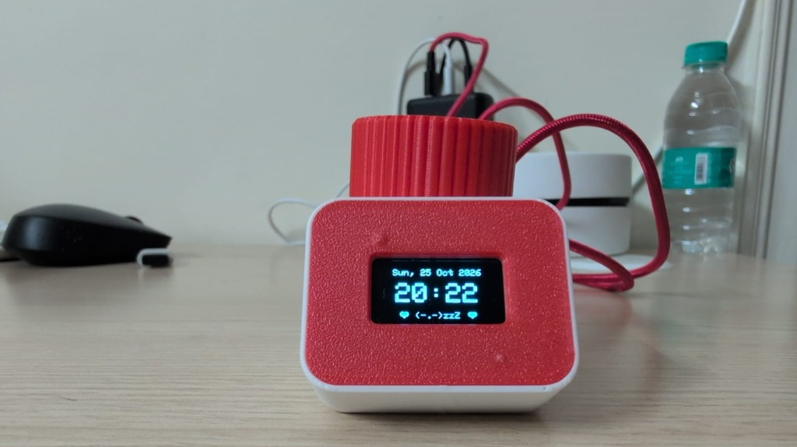
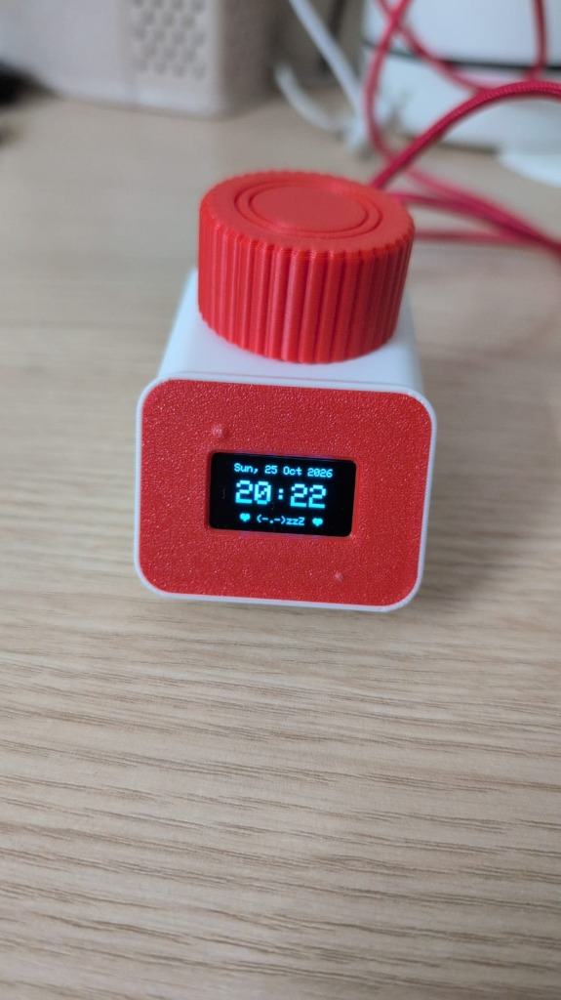
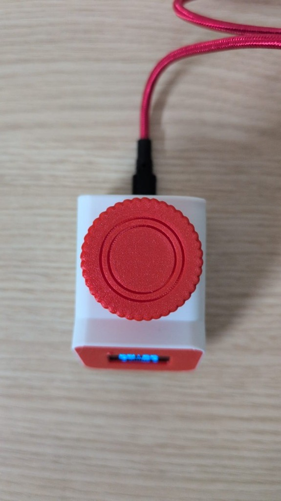

<div align="center">

# 🎀 IGLET

### An Adorable Connected Desk Companion, Focus Partner & Gift for Her

[](https://en.wikipedia.org/wiki/ESP8266)
[-00C853?style=flat-square)](3D%20Parts/)
[](LICENSE)
[](https://github.com/UrbanCircles/igor)

<br/>



*Iglet resting on a desk: live NTP clock, calendar date, and the adorable sleepy pet idle screen `♥ (-.-)zzZ ♥`.*

<br/>

[📖 Complete Gifting & Build Guide (IGLET_GUIDE.md)](IGLET_GUIDE.md) •
[⚡ Firmware Source (`iglet_sketch/`)](iglet_sketch/iglet_sketch.ino) •
[🖨️ 3D Models (`3D Parts/`)](3D%20Parts/)

</div>

---

## 🌟 What is Iglet?

**Iglet** is a charming, connected desk companion and tactile focus assistant designed as a personalized, thoughtful gift. 

Housed in a compact, snap-fit 3D-printed case with a retro rotary dial and an OLED screen, Iglet combines heartfelt companionship with everyday utility. It keeps your favorite person company throughout the workday with an interactive virtual pet, live Wi-Fi and worldwide Telegram messaging, relationship countdowns, calm breathing exercises, sweet reminders, and full Pomodoro/productivity timers.

Whether sitting beside a laptop or on a bedside table, Iglet provides a warm, tactile presence without needing a smartphone screen or intrusive notifications.

---

## 🙏 Credits & Origins

Iglet is built upon the wonderful foundation of **[Project IGOR](https://github.com/UrbanCircles/igor)** created by **[Urban Circles](https://makerworld.com/en/models/1000048-project-igor-open-source-offline-focus-partner)**.

- **Original Project**: [Project IGOR on GitHub](https://github.com/UrbanCircles/igor) by [Urban Circles](https://github.com/UrbanCircles)
- **Original 3D Model & Enclosure**: [MakerWorld Model #1000048 (Project IGOR - Open Source Offline Focus Partner)](https://makerworld.com/en/models/1000048-project-igor-open-source-offline-focus-partner)

### How Iglet Differs from the Original IGOR

While the original IGOR is a minimalist, offline productivity timer, **Iglet** reimagines the platform into an expressive, Wi-Fi-connected companion and gift device:

| Aspect | Base Project IGOR | Project IGLET |
| :--- | :--- | :--- |
| **Primary Goal** | Minimalist offline focus timer | Heartfelt desk companion, gift device & focus partner |
| **Connectivity** | Completely offline | Wi-Fi (ESP8266), Captive Portal, Local Web Server, mDNS |
| **Remote Messaging** | None | **Two-way Telegram Bot** (send notes from anywhere in the world) + local web sender |
| **Setup Experience** | Hardcoded in source code | **Zero-code phone portal** (`Iglet-Setup` hotspot at `192.168.4.1`) |
| **Clock & Time** | Relative timer minutes only | **Live NTP real-world clock & calendar** synced via `pool.ntp.org` |
| **Companion Features** | Idle taunt text (`IDLE?`) | **Virtual Pet** (feed, pet, play, 5-heart EEPROM affection level), 20 Love Notes, Countdown to Birthday/Anniversary, Compliment Roulette, Decision Maker |
| **Wellness & Mindfulness**| None | **4-2-6 Calming Breathing**, Mood check-in with Telegram alerts, gentle reminders |
| **Productivity Tools** | Count UP & Count DOWN | Count UP, Count DOWN, **Pomodoro (POMO)** cycles, EEPROM Flow minutes tracking |
| **Hardware Wiring** | Required soldering a ground Y-splitter | **Software GND on pin D5** — zero splitters or wire splicing required! |

---

## ✨ Features at a Glance

### 💌 Love & Connection
- **Two-Way Telegram Bot**: Text your bot from anywhere in the world while commuting or at work, and your message instantly pops up on her desk OLED! When she logs her mood on Iglet, you get an immediate notification on Telegram.
- **Wireless Phone Setup (`Iglet-Setup`)**: Connect phone to the `Iglet-Setup` hotspot to set her name, birthday, anniversary, and Wi-Fi credentials via a friendly captive portal — no code or reflashing required!
- **Live Desk Notes Sender (`http://iglet.local`)**: Anyone on the local Wi-Fi can open the dashboard in their browser to send surprise real-time notes to her screen.
- **20 Personal Love Notes (`Notes`)**: Curated love notes browseable using the rotary knob or displayed during auto-wake greetings.
- **Event Countdowns & Automated Celebrations (`Days`)**: Live countdowns to her Birthday and your Anniversary. When the special day arrives, Iglet automatically plays a surprise celebration animation with glowing candles and pulsing hearts.

### 🐾 Companion & Wellness
- **Interactive Virtual Pet (`Pet`)**: An animated desktop buddy! Pet it (wiggles + floating hearts), feed it (nom nom treat animation), or play together (happy hops + sparkles). Saves a 5-heart affection level directly into EEPROM.
- **Live NTP Desk Clock**: Automatic time and date sync with an adorable sleeping companion footer `♥ (-.-)zzZ ♥` when inactive.
- **Calm Breathing Exercise (`Breathe`)**: Guided 4-2-6 relaxation breathing with smooth pulsing graphic animations and configurable cycles (1–20).
- **Expressive Mood Check-in (`Mood`)**: Rotate through 5 cute pixel faces (Happy, Okay, Sad, Angry, Love) to receive a warm on-screen response and alert your partner via Telegram.
- **Compliment Roulette (`Spin!`)**: Slot-machine style compliment spinner with mechanical deceleration and sparkle effects.
- **Magic Decider (`Decide`)**: Animated 8-ball dilemma solver for date nights, food choices, or indecisive moments.
- **Auto-Wake & Gentle Reminders**: Periodic subtle wellness pings (hydration, stretching, posture) and configurable auto-wake screen greetings (`1m`, `30m`, `1h`, `2h`, `4h`).

### ⏱️ Tactile Productivity
- **Count UP Mode**: Open-ended stopwatch for deep work sessions.
- **Count DOWN Mode**: Quick rotary-dial timer for timed tasks and sprints.
- **Pomodoro Mode (`POMO`)**: Automated work and rest intervals.
- **Flow Minutes Tracking**: Keeps tally of total daily focus minutes saved persistently in EEPROM.

---

## 📷 Gallery & Hardware Design

<p align="center">
  
  &nbsp;&nbsp;
  
</p>

- **Tactile Rotary "Hat"**: A satisfying ribbed rotary dial with push-button click for effortless one-handed control.
- **Snap-Fit Enclosure**: 3D-printed in three parts (shell, faceplate, knob) with no screws, glue, or fasteners needed.
- **Dual-Color OLED**: Crisp 0.96" display with a warm yellow status header and cool blue interactive body.

---

## 🛠️ Bill of Materials (BOM)

| Component | Recommended Part | Approx. Cost | Notes |
| :--- | :--- | :--- | :--- |
| **Microcontroller** | Wemos D1 Mini (ESP8266) | ~$3.00 | USB-C version recommended |
| **Display** | 0.96" SSD1306 I2C OLED (128x64) | ~$2.50 | Yellow/Blue dual color |
| **Rotary Controller** | KY-040 Rotary Encoder | ~$1.50 | Includes built-in push button switch |
| **Enclosure** | 3D Printed Case (Shell, Faceplate, Hat) | ~$1.00 | PLA or PETG; files in [`3D Parts/`](3D%20Parts/) |
| **Power** | USB-C or Micro-USB Cable | — | Connects to phone charger or USB port |

> **Total Cost**: ~$7–$10 USD.

---

## 🔌 Pinout & Wiring

Thanks to a software-driven ground pin on `D5`, **you do not need any wire splitters or splicing**!

| Component Pin | D1 Mini Pin | GPIO | Function |
| :--- | :--- | :--- | :--- |
| **OLED SDA** | `D2` | GPIO4 | I2C Data line |
| **OLED SCL** | `D1` | GPIO5 | I2C Clock line |
| **OLED VCC** | `5V` (or `3V3`) | — | Power |
| **OLED GND** | `G` | — | Ground |
| **Encoder CLK** | `D6` | GPIO12 | Rotary Clock |
| **Encoder DT** | `D7` | GPIO13 | Rotary Direction |
| **Encoder SW** | `D4` | GPIO2 | Push Button Switch |
| **Encoder + (VCC)**| `3V3` | — | 3.3V Power |
| **Encoder GND** | `D5` | GPIO14 | **Software GND** (driven LOW — no Y-splitter needed!) |

---

## 🚀 Quick Start Guide

### 1. 3D Printing
Print the models located in [`3D Parts/`](3D%20Parts/):
1. **Shell**: Holds the D1 Mini board and secures the rotary encoder from above.
2. **Faceplate**: Holds the 0.96" OLED screen and snaps onto the front of the shell.
3. **Hat (Knob)**: Presses firmly onto the rotary encoder shaft.

*All parts are designed to be 100% press-fit with standard 0.2mm layer height on PLA or PETG.*

### 2. Flashing the Firmware
1. Open **Arduino IDE**.
2. Install **ESP8266 Board Support**:
   - `File` → `Preferences` → Add to *Additional Boards Manager URLs*:  
     `http://arduino.esp8266.com/stable/package_esp8266com_index.json`
   - `Tools` → `Board` → `Boards Manager...` → Search `esp8266` and click **Install**.
3. Install required libraries from `Tools` → `Manage Libraries...`:
   - **Adafruit SSD1306**
   - **Adafruit GFX Library**
4. Open [`iglet_sketch/iglet_sketch.ino`](iglet_sketch/iglet_sketch.ino).
5. Select Board: `Tools` → `Board` → `ESP8266 Boards` → **LOLIN(WEMOS) D1 R2 & mini**.
6. Select your COM port and click **Upload**.

### 3. Wireless Configuration (Zero-Code Setup)
1. Turn on Iglet. On your phone or laptop, connect to the Wi-Fi network:
   - **SSID**: `Iglet-Setup`
   - **Password**: *(None / Open)*
2. A setup portal will open automatically (or visit `http://192.168.4.1`).
3. Fill in her name, birthday, anniversary, timezone, and your home Wi-Fi details.
4. Tap **Save & Connect ✨**. All preferences are stored in EEPROM memory.

### 4. Telegram Bot Integration (Optional)
1. Open Telegram, search for `@BotFather`, and create a new bot with `/newbot`.
2. Copy the **HTTP API Bot Token**.
3. Open `http://iglet.local` on your local network, paste the token in the Telegram field, and hit Save.
4. Open your bot in Telegram and send `/start`. Iglet will pair immediately!

> For full gifting ideas, advanced customization, and step-by-step screenshots, see **[IGLET_GUIDE.md](IGLET_GUIDE.md)**.

---

## 🎮 Navigation & Controls

| Action | Control | Result |
| :--- | :--- | :--- |
| **Scroll Menu** | Rotate Dial | Cycles through all features (`Pet`, `Days`, `Spin!`, `Decide`, `Breathe`, `Mood`, `WiFi`, `Wake`, `UP`, `DOWN`, `POMO`, `Reset`) |
| **Confirm / Select**| Click Dial | Opens current item or triggers action |
| **Virtual Pet** | Rotate + Click | Choose `Pet`, `Feed`, or `Play` to raise happiness and love level |
| **Days / Clock** | Rotate in `Days` | Toggle between Anniversary countdown, Birthday countdown, and live NTP clock |
| **Calm Breathing** | Rotate + Click | Set cycle count (1–20) and begin guided 4-2-6 breathing |
| **Mood Check-in** | Rotate + Click | Select from 5 expressive faces; updates screen and alerts Telegram |
| **Reset Wi-Fi** | Rotate in `WiFi` | Navigate to Page 2 to re-launch the `Iglet-Setup` hotspot |
| **Wake from Sleep** | Turn or Click Dial | Instantly wakes the display back to the main menu |

---

## 📁 Repository Structure

```
Iglet/
├── 3D Parts/             # 3MF and STEP 3D models (Shell, Faceplate, Hats)
├── images/               # High-resolution photos of the assembled device
│   ├── iglet_front.jpg
│   ├── iglet_perspective.jpg
│   └── iglet_top.jpg
├── iglet_sketch/         # ESP8266 Arduino sketch & firmware
│   ├── iglet_sketch.ino  # Main firmware logic
│   ├── config.example.h  # Template for optional pre-flashed private secrets
│   └── config.h          # (Ignored by git) Private personal configuration
├── IGLET_GUIDE.md        # Comprehensive gift presentation and customization guide
├── LICENSE               # MIT License
└── README.md             # Project documentation
```

---

## 📜 License & Acknowledgements

- **Software & Firmware**: Released under the [MIT License](LICENSE).
- **Physical Design & Concept**: Enclosure 3D CAD models and original focus partner concept credited to **[Urban Circles](https://makerworld.com/en/models/1000048-project-igor-open-source-offline-focus-partner)** ([Project IGOR](https://github.com/UrbanCircles/igor)).

Made with ❤️ for someone special.
